<div align="center">
  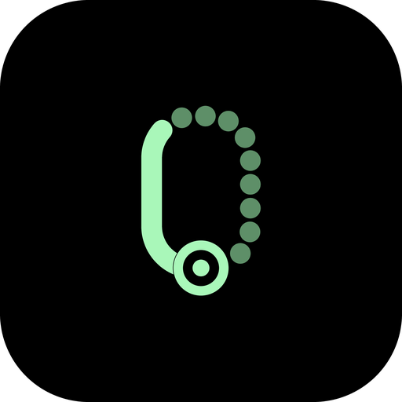
  <h1>TrackZero</h1>
  <p><b>A fast, offline cycling computer and GPX navigator.</b></p>
  <p>
    
    
    
  </p>
</div>

TrackZero is a cycling-first Android app built on the [CoMaps](https://codeberg.org/comaps/comaps) offline map engine.
Import a GPX route, ride it with turn-by-turn guidance on a dark, glanceable display, and record your ride, all
without an account or a network connection. It is designed to last a whole day on one charge.

<p align="center">
  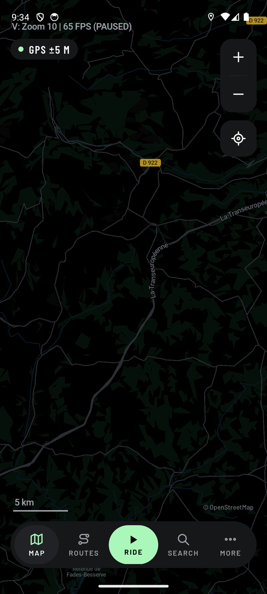
  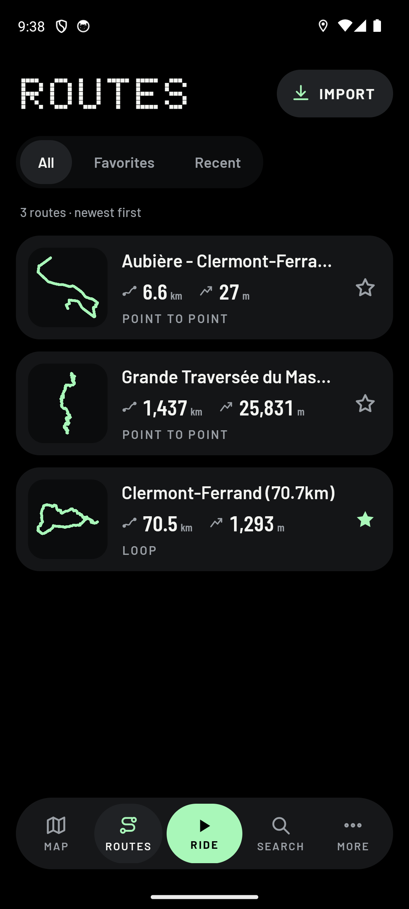
  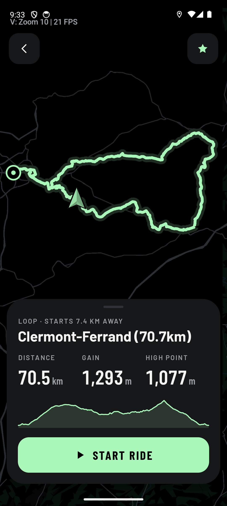
  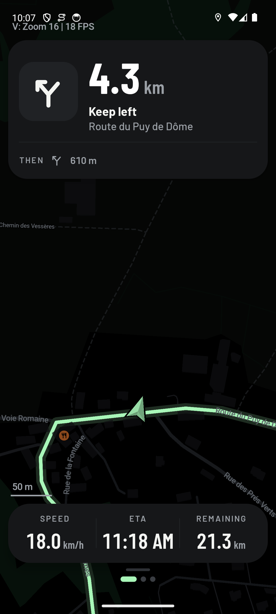
  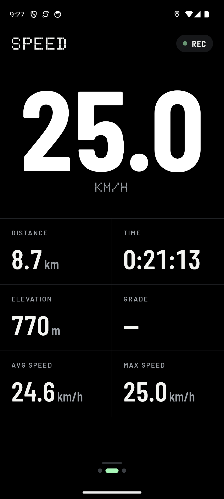
</p>
<p align="center">
  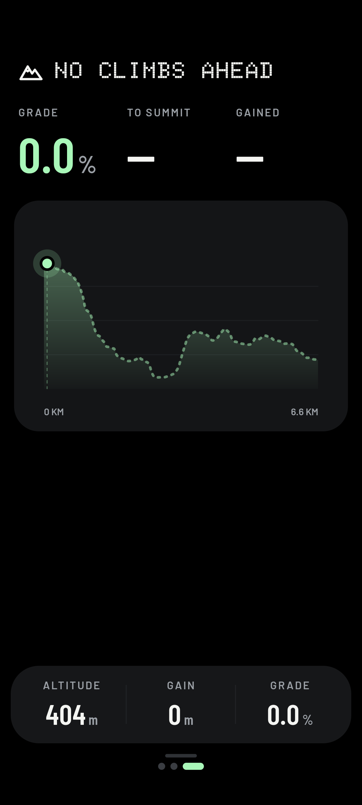
  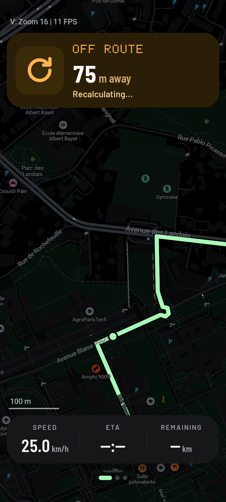
  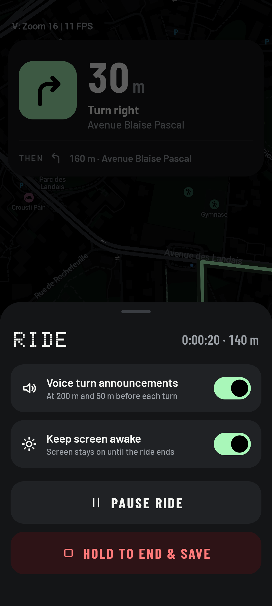
  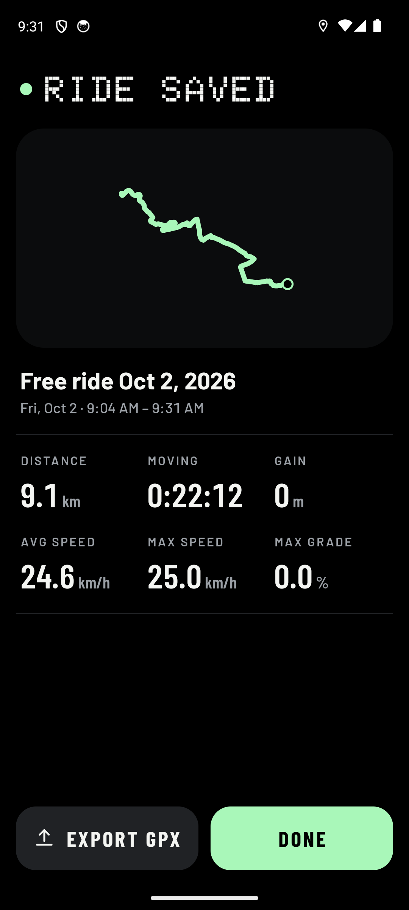
  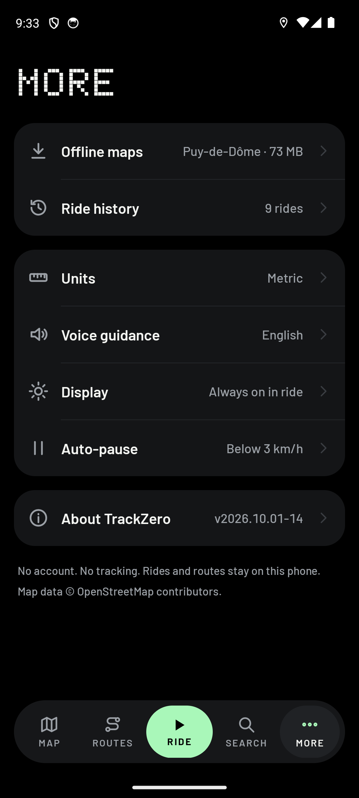
</p>

## Features

- **Your routes, offline.** Import GPX files from the file picker, or share them to TrackZero from any app. The
  library shows distance, climbing and loop / out-and-back / point-to-point at a glance; favorite, rename, delete.
- **Turn-by-turn on any GPX.** Turns are worked out from the track itself and checked against the map's junctions,
  with street names and spoken announcements at 200 m and 50 m.
- **Routing when you need it.** CoMaps' bicycle router gets you to the start of a route, back onto it when you leave
  it ("Recalculating…"), or to any place you search for (Navigate here). Roundabouts are announced by exit.
- **Three ride pages.** Map with turn card; a big speed page with distance, time, elevation, grade and averages; a
  climb page that finds the route's climbs, names them from the map, and shows grade, distance to the summit and the
  profile.
- **Ride recording.** Auto-pause, a crash-safe journal (a killed app reopens on the paused ride), ride history, and
  GPX export.
- **Offline search.** Places, summits, water, bike repair and cafés from the maps on the phone.
- **Offline maps.** Download the regions you ride in, over Wi-Fi or (when you agree) mobile data.
- **Private.** No account, no tracking, no analytics. TrackZero makes no network calls of its own; only map downloads
  you start reach the network.

### Built for battery

A ride can keep the screen on for hours, so the app works hard to do as little as possible:

- the map draws only while it is on screen, and the ride screen asks the display for 60 Hz instead of 120 Hz;
- one location fix a second, and with the screen off and nothing to announce, fixes arrive in batches so the phone
  can sleep;
- a café stop paused by hand turns GPS off until you come back;
- the compass sleeps while you ride (the GPS course gives the heading);
- the router keeps its road data for the ride and backs off when there is no route.

The reasoning behind these and every other design decision is in [TZ_DECISIONS.md](TZ_DECISIONS.md).

## Building

TrackZero is an **Android** app. The TrackZero interface lives in `android/app/src/main/java/app/trackzero`; the
repository still contains CoMaps' iOS and desktop apps, which build from the same core (see [iOS](#ios) below).

You'll need about 30 GB of free disk space and 8 GB of RAM. The first build compiles the whole C++ map engine and
takes a while (10 to 30 minutes); later builds are much faster.

### 1. Get the sources

```bash
git clone --recurse-submodules --shallow-submodules --branch trackzero \
    https://github.com/Gontary101/TrackZeroApp.git trackzero
cd trackzero
```

On a slow connection add `--filter=blob:limit=128k` to the clone (large files are then fetched on demand). If you
cloned without submodules: `git submodule update --init --recursive --depth 1`.

### 2. Install the build tools

<details open>
<summary><b>Linux (Ubuntu / Debian)</b></summary>

```bash
sudo apt install build-essential cmake ninja-build python3-venv jq optipng \
    qt6-base-dev qt6-svg-dev qt6-positioning-dev \
    libicu-dev libfreetype-dev libharfbuzz-dev libxrandr-dev libxinerama-dev libxcursor-dev libxi-dev
```

Arch and Fedora package lists are in [docs/INSTALL.md](docs/INSTALL.md#install-required-packages-for-your-specific-linux-distro).
</details>

<details>
<summary><b>macOS</b></summary>

```bash
xcode-select --install
brew install wget optipng cmake ninja qt jq
```
</details>

<details>
<summary><b>Windows</b></summary>

Build inside WSL 2 with Ubuntu and follow the Linux steps (see
[docs/INSTALL.md](docs/INSTALL.md#wsl-builds) for the details).
</details>

### 3. Prepare the repository

```bash
./configure.sh
```

This sets up a Python environment for the data tools and generates the map styles (TrackZero's dark cycling style
included) and their symbols. Run it again whenever you change anything under `data/styles/`.

### 4. Android

**Tools.** Install [Android Studio](https://developer.android.com/studio), or just the
[command line tools](https://developer.android.com/studio#command-line-tools-only), then these SDK packages:

```bash
sdkmanager "platform-tools" "platforms;android-36" "build-tools;36.0.0" \
           "ndk;28.2.13676358" "cmake;3.22.1"
```

The build needs **JDK 21** (`java -version`; Android Studio ships one: point `JAVA_HOME` at it if your system Java is
older) and the SDK location in `ANDROID_HOME`:

```bash
export ANDROID_HOME=$HOME/Android/Sdk           # macOS: $HOME/Library/Android/sdk
```

**Build and install a debug build** on a phone (USB debugging on) or an emulator:

```bash
cd android
./gradlew :app:assembleFdroidDebug -Parm64      # a phone; use -Px64 for an x86_64 emulator
adb install -r app/build/outputs/apk/fdroid/debug/TrackZero-*-fdroid-debug.apk
```

The debug build installs as `app.trackzero.debug`, beside a release build.

**Build a release.**

```bash
./gradlew :app:assembleFdroidRelease -Parm64
adb install -r app/build/outputs/apk/fdroid/release/TrackZero-*-fdroid-release.apk
```

Without your own key the release is signed with the repository's debug key (fine for your own phone). To sign it
with yours, create `android/app/secure.properties.release` (it is git-ignored):

```groovy
ext.secretReleaseStoreFile = '/path/to/your-release.keystore'
ext.secretReleaseStorePassword = 'store password'
ext.secretReleaseKeyAlias = 'key alias'
ext.secretReleaseKeyPassword = 'key password'
```

**Run the tests.**

```bash
./gradlew :app:testFdroidDebugUnitTest -Px64
```

**Useful options** for any Gradle command: `-Parm64`, `-Parm32`, `-Px64` or `-Px86` build one architecture instead of
all (much faster); `-PsplitAPK` makes one APK per architecture; `-Pnjobs=4` limits parallel compile jobs on a machine
with little RAM; `-Ppch` (precompiled headers) speeds the C++ build up by about 15 %.

On first launch TrackZero downloads the small world overview map; then open **More → Offline maps** and download
the regions you ride in.

### iOS

> TrackZero's own interface is Android only for now. The iOS project in this repository builds **CoMaps' iPhone
> app** from the same map engine (with TrackZero's engine changes), not TrackZero. It is useful for working on the
> shared core.

You need a Mac with Xcode (and an [Apple Developer](https://developer.apple.com/programs/) account to run on a real
device; the Simulator works without one).

1. Follow steps 1 to 3 above on the Mac (macOS tools, `./configure.sh`).
2. Open `xcode/CoMaps.xcworkspace` in Xcode.
3. In Xcode → Settings → Accounts, add your Apple ID and an "Apple Development" certificate.
4. Select the **Maps** project, then for each of the **CoMaps**, **CoMapsTests** and **CoMapsWidgetExtension**
   targets open *Signing & Capabilities*, choose your team, tick *Automatically manage signing* and set a unique
   bundle identifier (for example `com.yourname.comaps.debug`, `….tests`, `….debug.widgetextension`).
5. For a real device, remove the `com.apple.developer.carplay-maps` entry from
   `iphone/Maps/CoMaps-Debug.entitlements` (CarPlay needs an entitlement from Apple).
6. Pick the **CoMaps** scheme and a destination (a Simulator, your iPhone, or "My Mac (Designed for iPad)"), then
   *Product → Run*.

To feed a GPX track to the Simulator: `python3 tools/python/ios_simulator_load_gpx.py route.gpx`.

## Project layout

| Path | What's there |
| --- | --- |
| `android/app/src/main/java/app/trackzero/` | The TrackZero app: screens, ride service, follow engine, climbs, routing glue |
| `android/app/src/test/java/app/trackzero/` | Unit tests (follow engine, guide, climbs, formatting, GPX…) |
| `android/sdk/src/main/cpp/.../routing/BicyclePath.cpp` | The bicycle router bridge (paths without a routing session) |
| `data/styles/trackzero/` | The dark cycling map style |
| `design/logo/` | The logo and the script that generates every launcher icon from it |
| `tools/trackzero/` | Development tools (`emu_gps_play.py` rides a GPX on the Android emulator) |
| `TZ_DECISIONS.md`, `TZ_PROGRESS.md` | Why things are the way they are, and what was built and verified, phase by phase |

## Credits and license

TrackZero is a fork of [CoMaps](https://codeberg.org/comaps/comaps), the community-led successor of Organic Maps and
MAPS.ME. All the hard parts (the map engine, offline search, routing and map data processing) come from their
contributors; thank you.

Map data © [OpenStreetMap](https://www.openstreetmap.org/copyright) contributors, available under the ODbL.

TrackZero, like CoMaps, is licensed under the [Apache License 2.0](LICENSE). Third-party components keep their own
licenses (see `NOTICE` and `data/copyright.html`).
